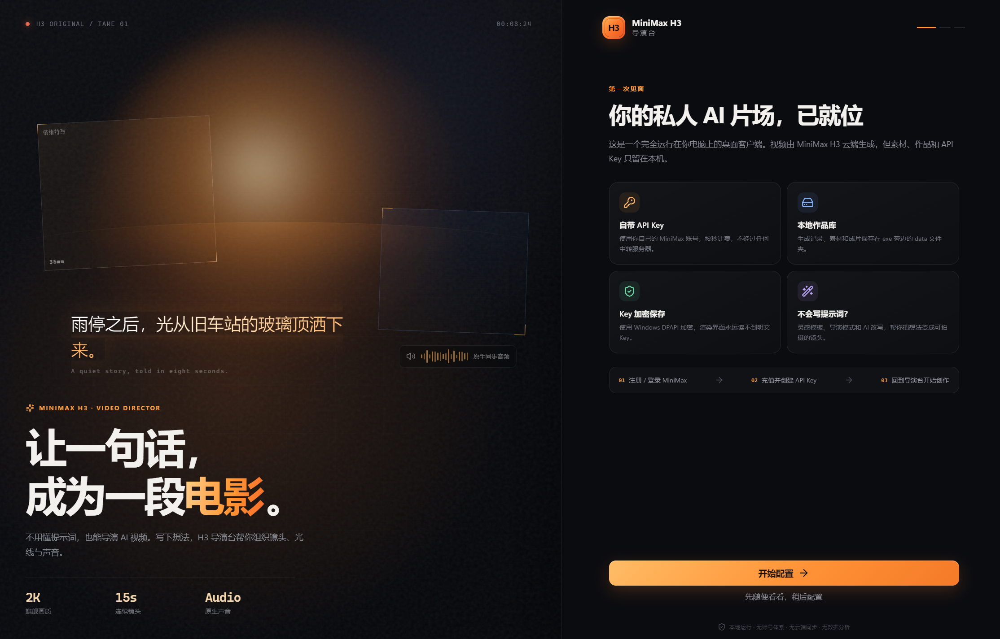
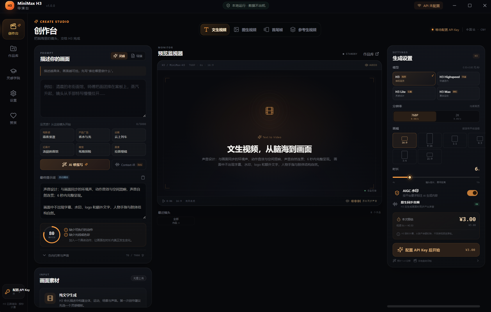

# MiniMax H3导演台 · MiniMax H3 Director

[中文](#minimax-h3导演台--minimax-h3-director) | [English](#minimax-h3-director--english)

[](#)
[](#)
[](https://www.minimax.io/)
[](LICENSE)



**一句话，成为一段电影。** MiniMax H3导演台是一个基于 MiniMax H3 API 的**本地导演工作台**：在桌面端写下一句画面描述，配置好镜头参数与参考素材，交给云端算力渲染成片，成品自动归档到本机。**渲染算力全在云端，与你的显卡、内存、硬盘配置无关；生成的内容全部落在本地，不依赖任何云端空间。**

> 程序包体积较大（约 290 MB，含 188 MB 主程序，超出 GitHub 单文件 100 MB 限制），故**不纳入本仓库**，请在 Releases 中获取可执行包。本仓库提供使用文档、界面截图与版本说明。

## 核心功能

| 能力 | 说明 |
|---|---|
| 本地导演工作台 | 基于 MiniMax H3 API 的桌面客户端，创作台 / 作品库 / 设置三段式界面，写提示词、调参数、管素材一站完成 |
| 云算力渲染 | 视频在 MiniMax 云端生成，**与本地硬件配置无关**：老旧笔记本、轻薄本、无独显机器同样可用 |
| 成片本地归档 | 生成结果自动下载到程序目录 `data\downloads\`，历史与素材统一放在 `data\`，不依赖云端空间，随时可整体备份 |
| 多种生成方式 | 文生视频、首尾帧生成视频（首帧 / 尾帧可控）、视频生成视频；也支持上传参考图片与参考视频 |
| 音画同步 | 支持「视频 + 音频」生成方式，可开启声音设计，一次产出带声音的成片 |
| 灵感与导演模式 | 「灵感模式」套用现成模板快速起步；「导演模式」由 AI 帮你组织镜头、光线与声音，不用会写分镜 |
| 后台任务与通知 | 点「开始生成」后任务在后台运行，完成后通过系统托盘通知，期间可继续别的工作 |
| 作品库 | 成片预览、导出、复用参数直接二次创作、删除；链接过期可「重新获取视频」并重新归档 |
| API Key 本机加密 | Key 仅保存在本机，使用 Windows 凭据（DPAPI）加密，不上传、不写日志；公用电脑可选「仅保存在内存」，退出即清除 |

## 界面预览

| 启动页 | 创作台 |
|---|---|
|  |  |

## 快速开始

1. 从 **Releases** 下载 `MiniMax-H3-Director-1.0.0-x64.zip`，解压到任意可写文件夹。
2. 双击 `MiniMax H3导演台.exe` 启动（应用未做代码签名，Windows 提示「未知发布者」时选「更多信息 → 仍要运行」）。
3. 首次启动按引导填写 MiniMax API Key：没有账号可先注册，创建以 `sk-` 开头的 Key 后粘贴，点「测试连接」通过即「保存并进入」；也可选「先随便看看，稍后配置」。
4. 在「创作台」写下画面描述，选择模型、分辨率、画幅、时长，需要时上传参考图片 / 首尾帧 / 参考视频。
5. 点「开始生成」，等待托盘通知；成片进入「作品库」，文件默认在 `data\downloads\`。

完整步骤、备份与常见问题见仓库内 [`使用说明.txt`](使用说明.txt)。

## 生成方式说明

| 方式 | 输入 | 适用场景 |
|---|---|---|
| 文生视频 | 一段文字描述 | 从零构思镜头、快速试片 |
| 首尾帧生成视频 | 首帧图 / 尾帧图 + 描述 | 需要精确控制起止画面、做转场或衔接 |
| 视频生成视频 | 参考视频（+ 描述） | 已有素材的改造、风格与运动延续 |
| 视频 + 音频 | 以上任一方式 + 声音设计 | 需要成片直接带声音 |

## 数据与隐私

- **无登录、无云端同步、无行为统计。** 除调用 MiniMax API 生成视频外，客户端不向任何服务器上传数据。
- 历史记录、素材、配置与 API Key 都在 exe 同目录的 `data\` 文件夹中；Key 使用 Windows DPAPI 加密，或按设置仅保存在内存。
- 程序目录不可写时，应用自动改用用户目录，实际路径可在「设置 → 本地数据」查看。
- 备份：直接复制 `data\` 文件夹到其他位置即可；更新版本时保留 `data\`，解压新包覆盖程序文件。

## 计费与授权

| 项目 | 说明 |
|---|---|
| 生成费用 | 由 MiniMax 按秒从你的账户余额扣除，本应用不代收任何费用；界面预估费用仅供参考，最终以官方账单为准 |
| 赞赏 | 赞赏页完全自愿，不接入支付，不影响任何功能 |
| API 站点 | 中国站 Key 对应 `api.minimax.cn`，国际站对应 `api.minimax.io`，在设置中切换 |

## 常见问题

| 问题 | 处理方式 |
|---|---|
| 启动提示未配置 API Key | 到「设置」中填写并保存 |
| 测试连接失败 | 检查网络、Key 是否复制完整、账户是否有余额，确认站点（cn / io）是否匹配 |
| 视频链接过期 / 加载失败 | 在作品详情点「重新获取视频」，任务仍在有效期时会重新下载并归档到本地 |
| 程序目录不能写入 | 应用自动切换到用户目录，路径见「设置 → 本地数据」 |
| 想换机器继续用 | 复制整个 `data\` 目录到新机器同位置即可 |

## 仓库说明

```
minimax-h3-director/
├── README.md               # 本文件（中文默认 + English）
├── 使用说明.txt             # 随程序发布的完整使用说明
├── assets/
│   ├── screenshot-landing.png   # 启动页截图
│   └── screenshot-studio.png    # 创作台截图
├── LICENSE                 # MIT
└── .gitignore              # 忽略 data/、可执行文件与构建产物
```

- 本仓库不含可执行文件：`MiniMax H3导演台.exe`（188 MB）超过 GitHub 单文件限制，请从 Releases 获取。
- 版本：**1.0.0**（Windows x64）。

## License

MIT License。如需商用分发或二次开发授权，请通过仓库 Issue 联系。

---

# MiniMax H3 Director (English)

[中文](#minimax-h3导演台--minimax-h3-director) | [English](#minimax-h3-director--english)

**One sentence in, one film out.** MiniMax H3 Director is a **local director's workbench** built on the MiniMax H3 API: describe the shot on your desktop, set camera parameters and reference assets, and let cloud compute render it — the finished video is archived on your own machine. **Rendering runs entirely in the cloud, so it is independent of your GPU, RAM or disk; every generated asset stays local and needs no cloud storage.**

> The application bundle is large (about 290 MB, including a 188 MB main executable, above GitHub's 100 MB per-file limit), so it is **not** part of this repository. Download the runnable build from Releases; this repository carries the documentation, UI screenshots and version notes.

## Features

| Feature | Detail |
|---|---|
| Local director workbench | A desktop client on the MiniMax H3 API with three tabs — Studio, Library, Settings — for prompts, parameters and assets in one place |
| Cloud rendering | Videos are generated on MiniMax cloud compute, **independent of local hardware**: old laptops, ultrabooks and machines without a discrete GPU work equally well |
| Local archiving | Finished videos are downloaded automatically to `data\downloads\`, with history and assets under `data\` — no cloud quota, easy to back up as a folder |
| Multiple generation modes | Text-to-video, first/last-frame-to-video (controllable opening and closing frames), video-to-video, plus reference images and reference videos |
| Video with audio | Supports "video + audio" generation with sound design, producing a finished clip with sound in one pass |
| Inspiration and Director modes | "Inspiration" applies ready-made templates to get moving; "Director" has the AI organise shots, lighting and sound for you |
| Background jobs | Generation runs in the background and notifies you via the system tray when done — keep working meanwhile |
| Library | Preview, export, reuse parameters for a new take, or delete; expired links can be re-fetched and re-archived |
| Locally encrypted API key | The key stays on your machine, encrypted with Windows DPAPI (never uploaded, never logged); on shared PCs choose "memory only" and it is cleared on exit |

## Screenshots

| Landing | Studio |
|---|---|
|  |  |

## Quick Start

1. Download `MiniMax-H3-Director-1.0.0-x64.zip` from **Releases** and extract it to any writable folder.
2. Run `MiniMax H3导演台.exe`. The build is not code-signed; if Windows shows "Unknown publisher", choose "More info → Run anyway".
3. On first launch, follow the onboarding to add your MiniMax API key: create a key starting with `sk-`, paste it, click "Test connection", then save. You can also skip and configure it later in Settings.
4. In Studio, describe the shot, pick model, resolution, aspect ratio and duration, and upload reference images, first/last frames or a reference video if needed.
5. Click "Start generating" and wait for the tray notification; the result lands in Library, with the file under `data\downloads\`.

Full steps, backup notes and troubleshooting are in [`使用说明.txt`](使用说明.txt).

## Generation Modes

| Mode | Input | Good for |
|---|---|---|
| Text to video | A written description | Brainstorming shots, quick tests |
| First/last frame to video | Opening and/or closing frame plus description | Precise control of start and end, transitions, continuity |
| Video to video | A reference video (plus description) | Reworking existing footage, carrying style and motion |
| Video + audio | Any of the above with sound design | A finished clip that already has sound |

## Data and Privacy

- **No login, no cloud sync, no analytics.** Apart from calling the MiniMax API to render videos, the client uploads nothing.
- History, assets, settings and the API key live in `data\` next to the executable; the key is DPAPI-encrypted, or memory-only if configured.
- If the program folder is read-only, the app falls back to the user directory — the real path is shown in Settings → Local data.
- Backup: copy the whole `data\` folder. When updating, keep `data\` and overwrite the program files.

## Billing and Licensing

| Item | Detail |
|---|---|
| Render cost | Charged by MiniMax per second from your own balance; the app never resells or collects fees, and its estimate is indicative only — the official invoice is final |
| Donations | Entirely optional, no payment integration, nothing is gated behind it |
| API endpoints | China site keys use `api.minimax.cn`, international site keys use `api.minimax.io` — switch in Settings |

## FAQ

| Question | Answer |
|---|---|
| "API key not configured" on launch | Add and save the key in Settings |
| Connection test fails | Check network, copy the key fully, confirm account balance, and make sure the site (cn / io) matches the key |
| Video link expired / fails to load | Use "Re-fetch video" in the item detail; if the task is still valid, it re-downloads and archives locally |
| Program folder not writable | The app switches to the user directory automatically; see Settings → Local data |
| Moving to another machine | Copy the whole `data\` folder to the same relative location |

## Repository Layout

```
minimax-h3-director/
├── README.md               # This file (Chinese by default, English below)
├── 使用说明.txt             # Full user guide shipped with the app
├── assets/
│   ├── screenshot-landing.png   # Landing screen
│   └── screenshot-studio.png    # Studio screen
├── LICENSE                 # MIT
└── .gitignore              # Ignores data/, executables and build output
```

- No binaries in this repository: `MiniMax H3导演台.exe` (188 MB) exceeds GitHub's per-file limit — get it from Releases.
- Version: **1.0.0** (Windows x64).

## License

MIT License. For commercial redistribution or derivative licensing, open an issue in this repository.
